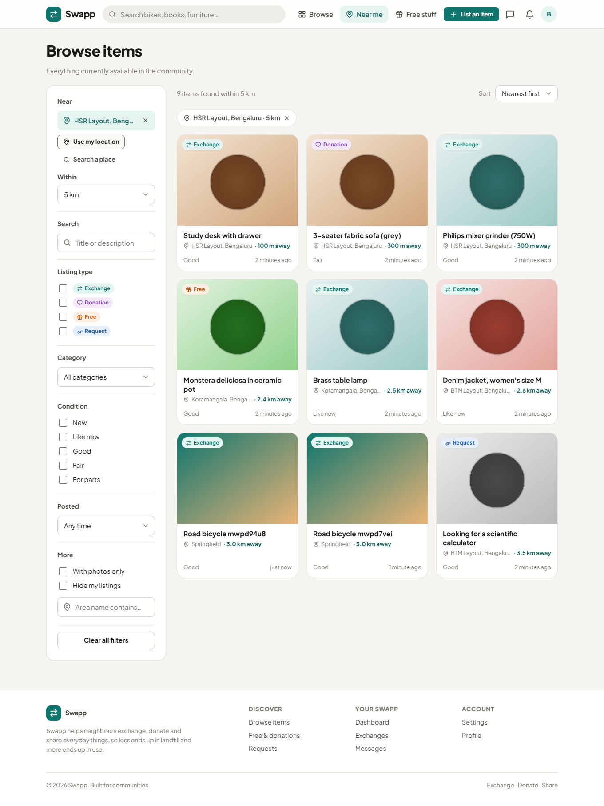
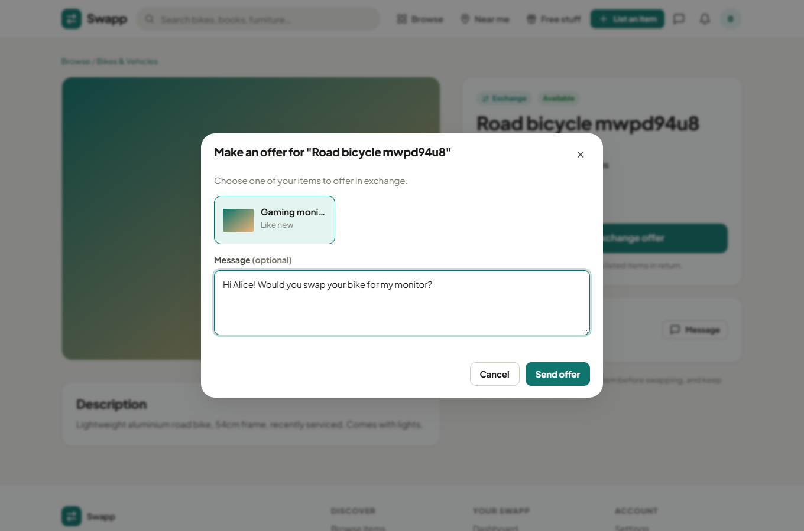
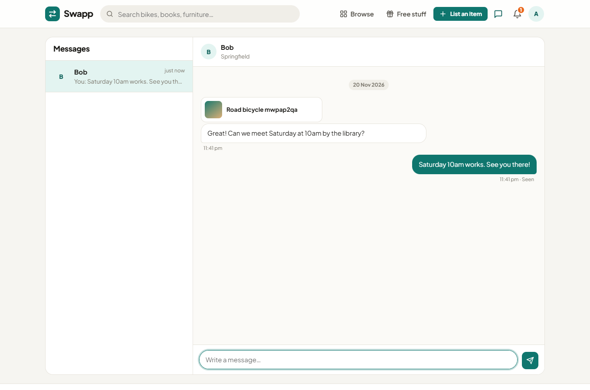

# Swapp

**A community platform for exchanging, donating, giving away and requesting everyday items, without money.**

Swapp lets neighbours list things they no longer use, offer their own items in exchange for someone else's, donate or give items away, and post requests for things they need. Every exchange is tracked from offer to hand-over, and only completes when **both** people confirm it.


## Features

| Area | What works |
| --- | --- |
| **Accounts** | Registration, sign-in/out, BCrypt password hashing, JWT in an HttpOnly `SameSite=Strict` cookie, profile editing, avatar upload, password change (revokes other sessions), "sign out everywhere", **forgot / reset password** and **email verification** by single-use emailed links, security alert emails |
| **Your data** | Download everything as JSON, and **delete your account** yourself (personal data erased, history kept anonymised for the other side), as India's DPDP Act requires |
| **Trust & safety** | **Report** listings, members or messages (evidence snapshot); two-way **block**; a **moderation queue** for admins to dismiss reports, take listings down or **suspend** members, which cancels their exchanges in progress |
| **Legal** | Privacy Policy, Terms (community guidelines, prohibited items) and Safety tips pages; 18+ and terms acceptance recorded at sign-up with its version |
| **Listings** | Create, edit, delete (soft delete keeps history), up to 6 photos per listing with reorder / cover selection, mark available / unavailable. Four listing types: **Exchange**, **Donation**, **Free giveaway**, **Request** |
| **Discovery** | **Near me**: radius search (1-50 km) from your GPS position or any searched place, sorted nearest first with distance on every card. Search over title and description (trigram-indexed), filters for category, multiple conditions, listing type, posted within, photos only and hide my listings, plus pagination. Every filter runs in the database |
| **Exchange offers** | Offer one of your items for someone else's; accept, decline or withdraw. Business rules enforced transactionally with row locks (see below) |
| **Exchange tracking** | Accepted offers create an exchange record. Both participants must confirm the hand-over; either can cancel, which releases both items |
| **Donations & giveaways** | A separate request workflow: users request the item, the owner chooses who receives it, then marks it handed over |
| **Notifications** | Persistent notifications for offers, acceptances, rejections, cancellations, exchange updates and donation requests, with read/unread state, delivered live over WebSocket |
| **Messaging** | Private one-to-one conversations with item references, unread tracking, read receipts, history paging and realtime delivery |
| **UI** | 26 responsive pages (desktop, tablet, mobile with bottom navigation), light/dark themes, loading skeletons, empty states, toasts, confirmation dialogs, inline validation |

### Exchange rules (enforced on the server)

- Users cannot make offers on their own listings or offer items they don't own.
- Only available items listed for exchange can be offered or requested.
- Duplicate pending offers for the same item pair are rejected, by the service and by a partial unique index.
- Only the owner of the requested item can accept or reject; only the offerer can withdraw.
- Accepting an offer, in **one transaction**: locks both items (`SELECT … FOR UPDATE`, in id order), re-checks availability, reserves both items, creates the exchange, and automatically closes every other pending offer involving either item, notifying the people affected.
- An item can never be in two active exchanges. This is guaranteed by row locking and backed by a unique index.
- Concurrency is covered by tests that fire conflicting accepts (and accept-versus-cancel) at the same instant from separate threads. Exactly one wins.

## Tech stack

- **Backend:** Java 21, Spring Boot 3.5, Spring Security, Spring Data JPA / Hibernate, Bean Validation, Spring WebSocket, Actuator, JJWT
- **Database:** PostgreSQL 17 with Flyway migrations (foreign keys, check constraints, partial unique indexes, pg_trgm search indexes, geo bounding-box index)
- **Frontend:** HTML5, CSS3 and vanilla JavaScript (ES modules), served by Spring Boot. No build step, and a strict Content-Security-Policy with no inline scripts
- **Testing:** JUnit 5, Mockito, MockMvc against a real PostgreSQL database, and Playwright browser journeys (including simulated GPS)
- **Ops:** Dockerfile (multi-stage, non-root), docker-compose, GitHub Actions CI with a PostgreSQL service container, Render Blueprint

## Screenshots

| | |
| --- | --- |
|  |  |
|  |  |
|  |  |
|  |  |

More in [`docs/screenshots`](docs/screenshots).

## Getting started

### Prerequisites

- Java 21 (Maven is included via the `mvnw` wrapper)
- PostgreSQL 14+ running locally, **or** Docker

### Option A: Docker Compose (app and database)

```bash
cp .env.example .env          # then edit the secrets in .env
docker compose up --build
# open http://localhost:8080
```

### Option B: run locally with your own PostgreSQL

```bash
# Create the databases (app + tests)
psql -U postgres -c "CREATE DATABASE swapp;" -c "CREATE DATABASE swapp_test;"

export DB_USERNAME=postgres DB_PASSWORD=yourpassword
export JWT_SECRET="$(openssl rand -base64 48)"
./mvnw spring-boot:run          # Windows: mvnw.cmd spring-boot:run
# open http://localhost:8080
```

Flyway creates the schema and seeds the categories on first start. If `JWT_SECRET` is not set in development, an ephemeral key is generated and a warning is logged. In the `prod` profile the application refuses to start without one.

### Demo data

Fill a running instance with realistic members, listings (with photos), offers, exchanges, donation requests and conversations, all created through the public API:

```bash
cd e2e && npm install && node seed.mjs http://localhost:8080
# demo logins: priya@swapp.demo, arjun@swapp.demo, ... (password: Passw0rd!)
```

### Running the tests

The integration tests use a **real PostgreSQL database** (`swapp_test`):

```bash
export TEST_DB_USERNAME=postgres TEST_DB_PASSWORD=yourpassword   # defaults: postgres / empty
./mvnw verify
```

89 tests cover unit logic, every controller, authentication and authorisation, rate limits and storage quotas, item CRUD and filters, radius search and distance sorting, image validation, the full offer and exchange journey, the donation workflow, messaging privacy, database constraints and concurrent conflicting operations.

Browser journey (registers two users and walks the whole product through the UI):

```bash
cd e2e && npm install && node journey.mjs http://localhost:8080 ./shots
```

## Environment variables

| Variable | Required in prod | Default (dev) | Description |
| --- | --- | --- | --- |
| `SPRING_PROFILES_ACTIVE` | yes (`prod`) | `default` | `prod` enforces secrets and secure cookies |
| `DB_URL` | yes | `jdbc:postgresql://localhost:5432/swapp` | JDBC URL of the PostgreSQL database |
| `DB_USERNAME` / `DB_PASSWORD` | yes | `postgres` / empty | Database credentials |
| `JWT_SECRET` | yes | ephemeral | HMAC signing key, at least 32 bytes |
| `JWT_EXPIRATION` | no | `P7D` | Session lifetime (ISO-8601 duration) |
| `COOKIE_SECURE` | no | `false` (`true` in prod) | Send the auth cookie over HTTPS only |
| `CORS_ALLOWED_ORIGINS` | yes | `http://localhost:8080` | Comma-separated allowed browser origins |
| `STORAGE_TYPE` | no | `database` | `database` stores images in PostgreSQL; `filesystem` stores them on a volume |
| `STORAGE_LOCAL_DIR` | if filesystem | `./data/uploads` | Upload directory for filesystem storage |
| `PORT` | no | `8080` | HTTP port (set automatically by most platforms) |
| `DB_POOL_SIZE` | no | `10` | Hikari connection pool size |
| `RATE_LIMIT_ENABLED` | no | `true` | Request throttling on sign-up, sign-in and writes (see ARCHITECTURE.md) |
| `PUBLIC_URL` | no | `RENDER_EXTERNAL_URL`, else `http://localhost:8080` | Base URL used in links inside emails |
| `CONTACT_EMAIL` | yes | `support@swapp.example` | Public contact for privacy questions and grievances (Privacy Policy, emails) |
| `MAIL_PROVIDER` | yes (`smtp`) | `log` | `log` writes emails to the application log; `smtp` delivers them |
| `MAIL_FROM` | with smtp | `no-reply@swapp.example` | Sender address, verified at the email provider |
| `SMTP_HOST` / `SMTP_PORT` | with smtp | empty / `587` | SMTP relay, e.g. `smtp-relay.brevo.com` (STARTTLS required) |
| `SMTP_USERNAME` / `SMTP_PASSWORD` | with smtp | empty | SMTP credentials (for Brevo: the SMTP login and an SMTP key) |
| `REQUIRE_EMAIL_VERIFICATION` | recommended | `false` | Unconfirmed members cannot post, offer, request, message or report. Needs `MAIL_PROVIDER=smtp` |
| `STORAGE_PER_USER` / `STORAGE_TOTAL` | no | `30MB` / `400MB` | Photo quota per user, and the site-wide ceiling at which uploads pause |

Secrets are only ever read from the environment. Nothing sensitive is committed (see `.gitignore`).

## Documentation

- [Architecture](docs/ARCHITECTURE.md): layers, data model, transactions and locking, security design
- [API reference](docs/API.md): every endpoint with request and response shapes
- [Deployment guide](docs/DEPLOYMENT.md): Render with Neon (free), Railway, AWS EC2 with RDS

## Project structure

```
src/main/java/com/swapp
├── config/        Security, WebSocket, typed configuration properties
├── security/      JWT service, auth filter, cookies, login and request rate limiters
├── common/        Base entity, error model, pagination, global exception handler
├── user/          Accounts, auth and profile (entity, repository, services, controllers, DTOs)
├── category/      Category reference data
├── item/          Listings, images, search specifications, item locking
├── offer/         Exchange offers
├── exchange/      Exchange tracking and two-sided completion
├── donation/      Donation and giveaway requests
├── notification/  Persistent notifications
├── messaging/     Conversations and messages
├── realtime/      WebSocket hub and authenticated handshake
├── storage/       Image validation and storage (database or filesystem)
└── stats/         Public landing-page stats
src/main/resources
├── db/migration/  Flyway SQL migrations
└── static/        HTML pages, css/app.css, js/ (api, ui, app and one module per page)
```

## License

[MIT](LICENSE)
